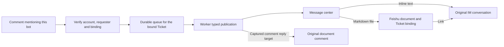

# Feishu document delivery and comment continuation

Native Feishu/Lark delivery converts selected Markdown **file artifacts** into cloud documents and sends the access links returned by Feishu metadata. Inline text, including Markdown text and tables, stays in the chat. Main and local result views retain the original artifact. The Worker publication schema is unchanged. The legacy CLI Feishu Source retains its existing behavior.

## Upgrade and permissions

Build/install this plugin revision and restart its DSH profile. For every existing native account, open Message center → account settings → Complete permissions and finish the QR update. New QR accounts request the same document capabilities automatically. Manual app configuration must grant the following tenant scopes, enable `drive.notice.comment_add_v1` over the existing WebSocket connection, and publish/approve the app configuration. Existing base messaging permissions alone do not enable documents.

- `docx:document:create`, `docx:document:readonly`, `docx:document:write_only`
- `docx:document.block:convert`
- `docs:document.comment:read`, `docs:document.comment:create`
- `docs:permission.member:create`, `drive:drive.metadata:readonly`

Every document API operation checks the account fingerprint. The app grants its original requester view/comment access; it does not publish the document to everyone in a group. Only that requester, with current account/source authorization, can mention the same bot to resume the bound task. Sharing a document to another person does not grant control of the Worker.

## Routing and replies

The callback reads the specific reply, quoted text and current document text through Feishu APIs. These external contents become a logged Trigger; they cannot choose a task, bot or destination. Duplicate notifications reuse the same request ID. Requests on one Ticket execute in receipt order after the current Worker becomes idle and reports a settled state. Other inputs cannot attach while a comment owns the active reply target. Both acknowledgements and publications use that target even if the model supplies another trigger ID. Main still receives the task report. No additional Agent Session is created.

Unknown documents, mentions of another bot, self-generated replies, other senders and human-stopped tasks do not start work. Account removal, source disablement and permission revocation prevent further execution or delivery. Message center displays rejected queued requests and their reasons. `feishuDocuments.contextChars` (default 24,000 per field) and `commentPages` (default 10) bound context collection; truncated document text is marked.

## Recovery and supported content

Creation, each block insertion batch and sharing have separate durable checkpoints. Successful stages are reused after retries and restarts. Known API rejections can retry the failed stage. Uncertain network outcomes stop automatic repetition. In Message center, verify the operation in Feishu, record a note and either confirm it was applied or allow retry after confirming it was not applied. An applied creation requires the existing document ID. Then retry the corresponding message part above. Successful parts are never resent. Uncertain comment sends use the existing per-part reconciliation.

Text, headings, lists, code and tables use Feishu's Markdown conversion API. Complete block subtrees are batched below its 1,000-block limit; a larger individual subtree produces a visible failure. Markdown image references remain visible source links instead of being fetched and uploaded automatically. Standalone image/file chat delivery is unchanged. Comments support text, links and converted Markdown artifacts; other binary attachments are reported as unsupported and remain downloadable locally.

The original artifact, document binding, queue and receipts remain in the existing database. These additive records do not rewrite released Session data. Before rollback, stop intake and preserve the state directory: older builds cannot service queued document comments, and database rollback cannot undo documents or replies already sent.

## Acceptance

Offline tests cover typed output selection, publication reuse, uncertain-outcome reconciliation, QR/repair manifests, bot event isolation, deduplication, sender checks, task stop, forged inputs, sequential Worker continuation and exact reply destinations. Live acceptance requires an owner-selected account: complete permissions, publish a Markdown artifact, open its link, mention the bot in two comments, and verify replies under each original comment. Offline tests do not establish live platform delivery.

API references: [Markdown conversion](https://open.feishu.cn/document/ukTMukTMukTM/uUDN04SN0QjL1QDN/document-docx/docx-v1/document/convert), [nested blocks](https://open.feishu.cn/document/ukTMukTMukTM/uUDN04SN0QjL1QDN/document-docx/docx-v1/document-block-descendant/create), [comment automation](https://open.feishu.cn/document/mcp_open_tools/feishu-cli/use-cases/agent-replies-to-doc-comments).
